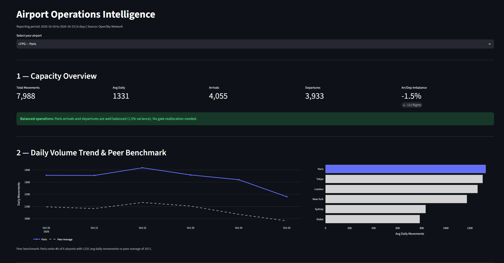
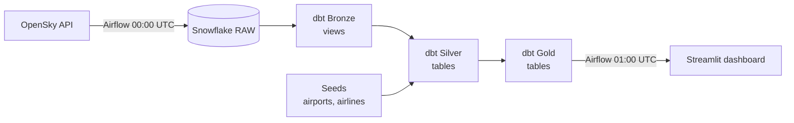

# Flight Analytics Pipeline

An end-to-end analytics engineering pipeline that pulls daily flight data for six global hub airports from the OpenSky Network API, models it in Snowflake with dbt, and serves an airport-operations dashboard in Streamlit.

Built following an analytics engineering course project. The data audit and the fixes documented below are my own.



---

## What it does

- **Extracts** arrivals and departures for KJFK, EGLL, LFPG, RJTT, OMDB and YSSY from the OpenSky REST API (OAuth2)
- **Loads** raw records into Snowflake on a nightly Airflow schedule
- **Transforms** them with dbt through Bronze → Silver → Gold layers, with 20 data tests
- **Visualizes** capacity, peak hours, airline concentration and route connectivity per airport in Streamlit

~40,000 flights over 7 days (Oct 20–26, 2026).

## Architecture



| Layer | Tool | Purpose |
|---|---|---|
| Extraction | Python, `requests` | OAuth2 client for OpenSky; 404 = valid empty result |
| Orchestration | Apache Airflow 2.10 (Docker Compose) | Extraction DAG at 00:00 UTC, dbt DAG at 01:00 UTC |
| Warehouse | Snowflake | RAW, BRONZE, SILVER, GOLD schemas |
| Transformation | dbt Core + `dbt_utils` | Medallion layers, surrogate keys, tests |
| Visualization | Streamlit, Plotly | Airport operations dashboard |
| Environment | Docker, GitHub Codespaces | Reproducible dev environment |

## Data model

- **Bronze** (`brz_raw_flights`, view): fixed column contract over RAW; entry-point tests
- **Silver** (`slv_flights`, `slv_airports`, `slv_airlines`, tables): deduplication with `ROW_NUMBER()`, MD5 surrogate key, duration, airline prefix; star-schema dimensions from seeds
- **Gold** (4 tables): daily airport traffic, route analysis, hourly activity, airline traffic

## What I found and fixed

All tests passed throughout. These issues were found by checking the numbers against each other and against the real world.

| Issue | Evidence | Fix |
|---|---|---|
| **Route double counting** | Flights between two tracked airports were counted at both ends. London → Paris was exactly 2×, and Sydney → Sydney ranked as the #2 busiest route | Count departures only; exclude same-airport routes. Sydney → Melbourne is now #1, matching reality |
| **False "volume declining" alert** | The newest day was only partly processed by OpenSky (621 flights vs ~6,800), creating a fake 90% crash | Exclude the most recent day from daily metrics |
| **Weekend mistaken for a trend** | The dashboard compared Tue–Thu to Fri–Sun and flagged −6.5% "decline" | Suppress trend alerts until 14 days exist, so same weekdays can be compared |
| **Local hour off by one** | Static UTC offsets ignore daylight saving; London, Paris and New York peak hours were shifted by 1h | Documented; correct approach is `CONVERT_TIMEZONE` with the IANA timezone |
| **Unsupported causal claim** | Dashboard attributed low Dubai counts to geopolitics | Replaced with the evidenced cause: limited OpenSky receiver coverage |
| **Postgres not restarting** | Airflow came back after a restart, its metadata DB didn't | Added `restart: always` |

## Known limitations

- **Grain:** Silver is one aircraft movement per airport, not one flight. 145 of 6,496 rows on Oct 24 were the same flight seen at two airports
- **Non-additive metrics:** `unique_aircraft` must not be summed across airports
- **Sampling bias:** rankings reflect six hub airports, not global market share (e.g. Lufthansa and United are absent because their hubs aren't tracked)
- **Entity grouping:** easyJet and easyJet Europe are separate rows; concentration risk should be measured by parent group
- **Airport misattribution:** OpenSky sometimes assigns flights to adjacent military fields (RJCJ vs New Chitose RJCC)
- **Loader is not idempotent:** a retried load inserts duplicates; Silver dedup absorbs it
- **dbt runs then tests:** `dbt build` would stop bad data before Gold is rebuilt
- **Runs only while the Codespace is on;** production would use an always-on scheduler

## Run it

```bash
cp .env.example .env            # add OpenSky and Snowflake credentials
docker compose up -d            # Airflow + Postgres
# Airflow UI on port 8080 → unpause both DAGs

pip install streamlit plotly
set -a; source .env; set +a
python3 backfill_7days.py       # optional: 7 days of history
streamlit run streamlit/backfill_dashboard.py
```

## Repository structure

```
dags/                  Airflow DAGs (extraction, dbt transform)
include/               OpenSky client, Snowflake loader
dbt/models/            bronze/ silver/ gold/ + tests
dbt/seeds/             airport and airline reference data
streamlit/             dashboard
backfill_7days.py      7-day historical load
docker-compose.yaml    Airflow, Postgres, Streamlit
```

## Next steps

- Replace `dbt run` + `dbt test` with `dbt build`
- Make the extraction DAG trigger dbt directly instead of a time offset
- Timezone-aware local hours; parent-group mapping for airlines
- Move the backfill logic into dbt so there is one source of truth
